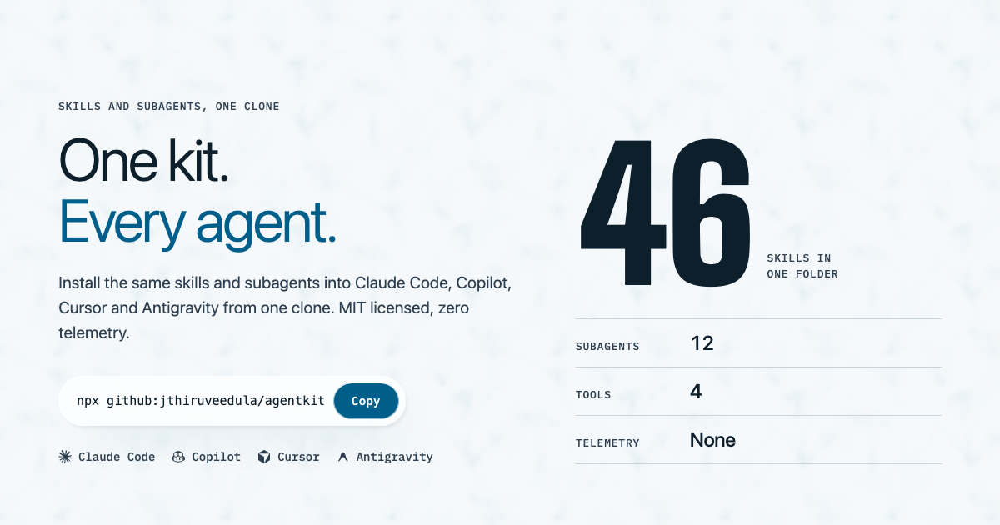
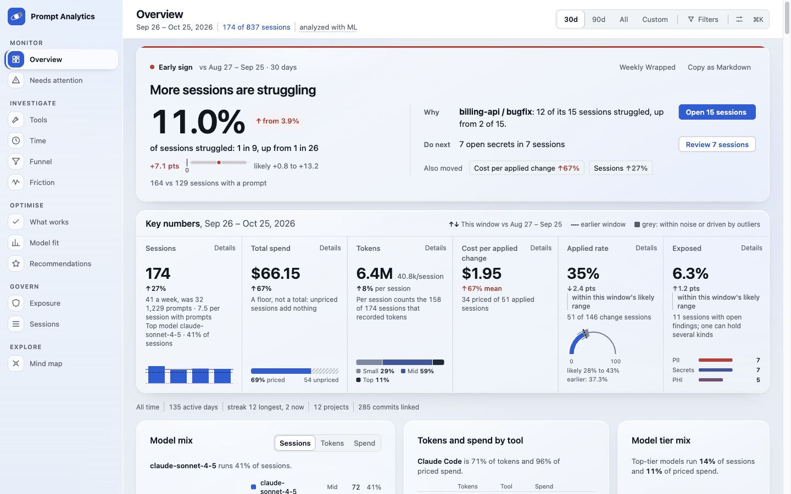

<div align="center">

<a href="https://jthiruveedula.github.io/agentkit/">
  
</a>

# agentkit

**Skills and subagents for GenAI, data engineering and ML, authored once and installed into
Claude Code, GitHub Copilot, Cursor and Antigravity with one command.**

[](https://github.com/jthiruveedula/agentkit/actions/workflows/ci.yml)
[](https://github.com/jthiruveedula/agentkit/releases)
[](https://jthiruveedula.github.io/agentkit/)
[](https://github.com/jthiruveedula/agentkit/blob/main/LICENSE)
<br>
[](https://github.com/jthiruveedula/agentkit/blob/main/.github/workflows/ci.yml)
[](https://github.com/jthiruveedula/agentkit/releases)
[](https://github.com/jthiruveedula/agentkit#install-matrix)

[**Website**](https://jthiruveedula.github.io/agentkit/) ·
[Quickstart](#quickstart) ·
[Which skill?](#start-here-which-skill-or-agent) ·
[Orchestration](#orchestration) ·
[Token economy](#token-economy) ·
[Catalog](#skill-catalog) ·
[Prompt analytics](#prompt-analytics) ·
[Contribute](#build--test--contribute)

</div>

---

An orchestrator plans and delegates to specialist subagents; token-economy tooling measures and
caps what each session costs. Deterministic scripts do the repeatable work; the model does the
judging.

| | |
|---|---|
| **44 skills, 12 subagents** | Data platforms, pipelines, data quality, RAG and evals, ML lifecycle, frontend motion and 3D, review and debugging. |
| **4 tools, 1 source** | Each skill is one `SKILL.md`; `build.py` emits the Claude Code, Copilot, Cursor and Antigravity adapters. |
| **Session costs you can see** | Live context budget with pause/resume, per-session spend audits, prompt analytics. |
| **Private** | MIT licensed. No telemetry, no external calls beyond what you run yourself (`sync-external.sh`, `gh`, `npm`). |

## Quickstart

```sh
# macOS / Linux: clone once, symlink everywhere
git clone https://github.com/jthiruveedula/agentkit.git ~/agentkit
cd ~/agentkit && ./install.sh
```

<details>
<summary><b>Windows, npx, uvx</b></summary>

```powershell
# Windows
git clone https://github.com/jthiruveedula/agentkit.git $HOME\agentkit
cd $HOME\agentkit; .\install.ps1
```

```sh
# No clone: run straight from the repo (Node on PATH)
npx github:jthiruveedula/agentkit

# No clone: Python console script
uvx --from git+https://github.com/jthiruveedula/agentkit agentkit
```

More options in the [install matrix](#install-matrix).

</details>

Recommended for Claude Code: a live session token budget with automatic pause/resume (see
[Token economy](#token-economy)):

```sh
python3 ~/.claude/skills/context-budget/scripts/install_hooks.py
```

> [!TIP]
> Re-running install is always safe. Already-linked files are skipped, and any file it didn't
> create is backed up (`<file>.bak.<timestamp>`), never overwritten. Your own
> `~/.claude/CLAUDE.md` is left untouched. `git pull` updates every tool instantly, since they
> read through the symlinks. Add `--with-external` to also fetch every pinned
> [external skill source](#external-skills).

## Start here: which skill or agent?

| Need | Skill | Subagent |
|---|---|---|
| A goal that spans several specialties | `orchestrate` | `orchestrator` |
| Platform choice (warehouse, orchestrator, batch vs. stream) | `data-architect` → ADR | `data-platform-architect` |
| Cloud-specific data work (GCP / AWS / Azure / Databricks) | `data-eng-router` | — |
| New dbt model, Airflow DAG, Dagster asset, Spark job | `pipeline-scaffold` | `pipeline-engineer` |
| Pipeline tests, data contracts, PII, freshness | `data-quality-standards` | `data-quality-engineer` |
| RAG, LLM features, agents, evals, LLM cost | `genai-engineering` | `ml-engineer` |
| Train, evaluate, deploy, monitor a model | `ml-lifecycle` | `ml-engineer` |
| UI, animation, scroll effects, 3D / WebGL | `frontend-motion-3d` | `frontend-engineer` |
| Rough idea → spec → task list | `spec-writer` | — |
| Failing test or crash | `debug-loop` | — |
| Prove a change works (tests, lint, types) | — | `verifier` |
| Review a diff or PR | `pr-review` | `reviewer` |
| Audit an MCP server before trusting it | `mcp-security-review` | — |
| Session getting long / expensive | `context-budget`, `token-saver` | — |
| Why sessions are slow; what to automate | `session-insights` | — |

## Orchestration

`orchestrate` is a lead-agent persona; `orchestrator` is the same thing as a subagent that may
spawn the roster agents below (via an `Agent(...)` allowlist, nested at most one level by design).

1. **Decide the shape.** Fan out only for independent work; multi-agent runs cost roughly 3-15×
   the tokens of one agent.
2. **Write a plan** to `.agentkit/plan.json` and validate it:
   `python3 skills/orchestrate/scripts/plan_check.py .agentkit/plan.json` rejects unknown owners,
   missing deps, cycles, and waves wider than 5, then prints the execution waves.
3. **Delegate wave by wave** in parallel, each task with an objective, output format, scope, and
   turn budget.
4. **Verify externally** with `verifier` (runs the project's real checks, never self-grades), then
   `reviewer`.
5. **Synthesize** one result: what changed, evidence, open risks.

`spec-writer` ends each spec with a roster-owned task list, so a spec can feed straight into a
plan.

### Subagents

| Agent | Role | Model |
|---|---|---|
| `orchestrator` | Plans, delegates to the others, verifies, synthesizes | inherits main |
| `researcher` | Read-only investigation with cited evidence | sonnet |
| `implementer` | Code changes scoped to the files a task names | sonnet |
| `test-writer` | Smallest test that fails if the logic breaks | sonnet |
| `verifier` | Runs tests/lint/types/schema checks; evidence only | sonnet |
| `reviewer` | Correctness and scope-creep review, read-only | sonnet |
| `doc-writer` | README/CHANGELOG/reference docs; never edits source | sonnet |
| `data-platform-architect` | Platform decisions recorded as ADRs | sonnet |
| `pipeline-engineer` | Implements pipelines from a decided architecture | sonnet |
| `data-quality-engineer` | Checks for the risks the pipeline flagged | sonnet |
| `ml-engineer` | ML and GenAI work against a named metric | sonnet |
| `frontend-engineer` | UI, motion, and 3D within a perf/a11y budget | sonnet |

> [!NOTE]
> Subagents ship for Claude Code and Antigravity. Copilot and Cursor have no agent equivalent, a
> known gap documented in [`AGENTS.md`](AGENTS.md).

## Token economy

Every turn re-reads the whole context, so cost grows with session length. On real usage, a
handful of long sessions held ~97% of all cache re-reads.

| Step | Tool | What it does |
|---|---|---|
| **Measure** | `token-saver/scripts/session_audit.py` | Per-session turns, startup context, fresh input, cache reads and output from Claude Code transcripts; flags long sessions. |
| **Understand** | `session-insights/scripts/insights.py` | Prompt and friction analysis (vague asks, corrections, interrupts, tool errors, re-reads, repeats), session outcomes, cost by intent and subagent, ranked suggestions. `--save` keeps a weekly trend, `--html` renders a dashboard, `--draft-commands` turns repeated prompts into slash commands, `--incidents` feeds `memory-sync`. |
| **Nudge** | `nudge_hook.py install` | UserPromptSubmit hook that catches vague task prompts live and asks the agent to state its target and done-condition first. Advisory, never blocks. |
| **Cap** | `context-budget` hooks | Past `AGENTKIT_BUDGET_TOKENS` (default 200k) the agent finishes its step, writes a checkpoint to `~/.agentkit/checkpoints/`, and asks for `/compact` or `/clear`; the checkpoint is re-injected on resume. Warns once per `AGENTKIT_BUDGET_STEP` (50k). |
| **Read less** | `token-saver`, `context-compressor` | Search before read, line ranges, diff-first; checkpoint template and linter. |
| **Compress shell output** | `./install.sh --with-boost` | Optional [jfrog/boost](https://boost.jfrog.com) wiring (see [CLI token savings](#cli-token-savings)). |

Script paths are relative to `skills/`; run them with `python3`.

## Skill catalog

44 skills. The live table is the generated [`AGENTS.md`](AGENTS.md), rebuilt from
`skills/*/SKILL.md` on every `make build`.

<details open>
<summary><b>Orchestration & dev loop</b></summary>

| Skill | What it does |
|---|---|
| `orchestrate` | Lead-agent persona: validated plan, parallel waves to roster subagents, external verification, one synthesized result. |
| `spec-writer` | Rough idea → problem, scope, non-goals, acceptance criteria, and a roster-owned task list. |
| `debug-loop` | Hypothesize-test-narrow loop until root cause is found. |
| `pr-review` | Correctness bugs and scope creep, posted as PR-level comments. |
| `prompt-enhancer` | Classifies a rough prompt's intent (9 categories) and rewrites it with that intent's pattern. |
| `skill-forge` | Scaffolds a new compliant skill from a one-line description. |
| `daily-standup` | Commits/PRs/issues since last standup → did/doing/blocked. |
| `meeting-to-actions` | Notes or transcript → action items with owners and dates. |

</details>

<details open>
<summary><b>Data engineering</b></summary>

| Skill | What it does |
|---|---|
| `data-architect` | Storage/compute/orchestration/streaming decisions, recorded as ADRs. |
| `data-eng-router` | Detects GCP/AWS/Azure/Databricks from task vocabulary and routes to that vendor's skill. |
| `pipeline-scaffold` | dbt model, Airflow DAG, Dagster asset, or PySpark job with medallion naming + test stub. |
| `data-quality-standards` | Schema, freshness, volume, idempotency, PII checks, and dbt data contracts. |

</details>

<details open>
<summary><b>GenAI & ML</b></summary>

| Skill | What it does |
|---|---|
| `genai-engineering` | RAG, agents, eval harnesses (incl. RAG metrics and LLM-judge bias controls), guardrails, cost/latency levers. |
| `ml-lifecycle` | Framing, leakage-safe splits, baselines, experiment tracking, registry, serving, drift monitoring. |

</details>

<details open>
<summary><b>Frontend, motion & 3D</b></summary>

| Skill | What it does |
|---|---|
| `frontend-motion-3d` | Effect → lightest tool (CSS, Motion, GSAP/ScrollTrigger, three.js/R3F, HyperFrames), with a 60fps/LCP budget, reduced-motion, and WebGL fallback. |

</details>

<details open>
<summary><b>Token economy, memory & safety</b></summary>

| Skill | What it does |
|---|---|
| `context-budget` | Live context budget hooks with checkpoint-based pause/resume. |
| `token-saver` | Surgical reads, terse output, and `session_audit.py` for real spend. |
| `context-compressor` | Checkpoint template and linter for long sessions and handoffs. |
| `smart-navigator` | Structure-first repo reconnaissance: manifests + tree, then entry points inward. |
| `memory` | Durable local memory (observations, facts, corrections) in SQLite. |
| `session-insights` | Prompt analytics + friction report with ranked productivity suggestions. |
| `memory-sync` | Mines recent sessions for recurring agent mistakes and writes durable fixes. |
| `mcp-security-review` | `mcp_scan.py` flags unpinned packages, secrets in config (names only), broad filesystem roots, unauthenticated remotes, shell wrappers. |
| `setup-guardian` | This repo's health checks: dist freshness, install targets, SHA pins, skill counts. |
| `doc-standards` | Professional house style for Word/Excel/PDF/PowerPoint output. |
| `humanizer` | Grammar fix and rewrite of text, docs and slides that keeps facts, code and voice; `detect.py` scores AI tells with line refs and guards numbers/code. |

</details>

<details>
<summary><b>External routers</b>: 15 thin skills that wire in the pinned <a href="#external-skills">external sources</a> on demand</summary>

| Skill | Routes to |
|---|---|
| `ext-diagrams` | Architecture diagrams, flowcharts, sequence diagrams (`diagram-design`) |
| `ext-ui-ux` | UI/UX design toolkit, when named explicitly |
| `ext-hallmark` | Frontend design via `nutlope/hallmark`: every UI change passes its anti-slop Floor and `sloplint`; new pages get its full design flow |
| `ext-seo` | SEO setup and audits via `AgriciDaniel/claude-seo`; `frontend-engineer` ships its baseline on every public page |
| `ext-security-audit` | Security reviews via `cloudflare/security-audit-skill`; `implementer`, `reviewer` and `pr-review` apply it at trust boundaries |
| `ext-rea` | Reverse engineering of shipped artifacts (binaries, bundles, APKs, crash reports, live sites) via the REA MCP server |
| `ext-codegraph` | Symbol search, call paths and blast radius |
| `ext-cli-ops` | Shell-output compression with jfrog/boost |
| `ext-meta-muse` | Meta Muse image generation via a pinned MCP server |
| `ext-gcp` · `ext-aws` · `ext-azure` · `ext-databricks` | Vendor and community cloud skills |
| `ext-systems-design` | System design references |
| `ext-gap-discovery` | Search the awesome-agent-skills index before writing a new skill |

</details>

## Prompt analytics

<p align="center">
  <a href="https://jthiruveedula.github.io/agentkit/prompt-analytics/">
    
  </a>
</p>

`packages/prompt-analytics` is a local-first analytics package for your own AI coding sessions.
It reads Claude Code, Copilot, Cursor, Antigravity and opencode history into a local DuckDB store
and builds a one-page dashboard: spend and time, the prompt-to-outcome funnel, friction hotspots,
what works, repeated prompts, and a review queue for secrets or PII you pasted.

```bash
cd packages/prompt-analytics
uv run --frozen prompt-analytics run     # scan, analyze, open the dashboard
```

- **Private by default.** No session data leaves the machine. Secrets, API keys, emails and
  tokens are redacted before anything is stored; the sensitive-data panel keeps counts and masked
  previews only.
- **Adapts to your machine.** `basic` (stdlib + DuckDB), `ml` (scikit-learn) and `deep` (local
  embeddings) tiers are picked from what is installed.
- **Adapts to your data.** Single-tool users and sparse histories get layouts that fit, not empty
  charts.

See the [demo page](https://jthiruveedula.github.io/agentkit/prompt-analytics/) (mock data only)
and `docs/prompt-analytics/` for the design notes.

## Deterministic where it matters

Repeatable decisions live in stdlib-only scripts with tests, so behavior is identical on all four
tools.

<details>
<summary><b>All 17 scripts</b></summary>

| Script | Does |
|---|---|
| `orchestrate/scripts/plan_check.py` | Validates a plan and prints execution waves |
| `context-budget/scripts/budget_hook.py` | Measures live context; pause notice and resume injection |
| `context-budget/scripts/install_hooks.py` | Idempotent hook install/uninstall in `settings.json` |
| `token-saver/scripts/session_audit.py` | Per-session token spend from transcripts |
| `token-saver/scripts/estimate.py` | File token estimate + read strategy |
| `mcp-security-review/scripts/mcp_scan.py` | MCP config risk scan; exit 1 on high findings |
| `prompt-enhancer/scripts/classify.py` | Intent classification (`--selftest` golden cases) |
| `data-eng-router/scripts/classify.py` | Cloud/platform detection |
| `data-architect/scripts/adr.py` | ADR scaffolding |
| `pipeline-scaffold/scripts/scaffold_pipeline.py` | Pipeline scaffolding |
| `context-compressor/scripts/checkpoint.py` | Checkpoint render + lint |
| `smart-navigator/scripts/map.py` | Repo manifest + tree map |
| `memory-sync/scripts/rank_patterns.py` | Ranks recurring session patterns |
| `session-insights/scripts/insights.py` | Prompt analytics, outcomes, cost, trend, dashboard, command drafts |
| `session-insights/scripts/nudge_hook.py` | Live vague-prompt nudge hook (`install`) |
| `setup-guardian/scripts/doctor.py` | Repo health checks (`--watch`) |
| `skill-forge/scripts/scaffold.py` | New-skill scaffolding |

</details>

## Install matrix

| Method | Command | Needs on PATH |
|---|---|---|
| Clone + `install.sh` (macOS/Linux) | `git clone … && cd agentkit && ./install.sh` | git, sh |
| Clone + `install.ps1` (Windows) | `git clone …; .\install.ps1` | PowerShell |
| npx, straight from GitHub | `npx github:jthiruveedula/agentkit` | Node |
| GitHub Packages | `npm install -g @jthiruveedula/agentkit` | Node + one-time login |
| uvx | `uvx --from git+https://github.com/jthiruveedula/agentkit agentkit` | uv |
| pipx | `pipx install git+https://github.com/jthiruveedula/agentkit` | pipx |
| Claude Code plugin | `/plugin marketplace add jthiruveedula/agentkit` | Claude Code |

| Target tool | Linked into | Flag |
|---|---|---|
| Claude Code | `~/.claude/{skills,agents}` | `--tools=claude` |
| GitHub Copilot | VS Code user prompts dir, `copilot-instructions.md` | `--tools=copilot` |
| Cursor | `~/.cursor/rules/`, `~/AGENTS.md` | `--tools=cursor` |
| Antigravity | `~/.antigravity/{rules,workflows}` | `--tools=antigravity` |

Combine with commas (`--tools=claude,cursor`). `--copy` for machines without symlink privileges.
`./install.sh uninstall` removes everything it created and restores backups;
`./install.sh version` / `upgrade` (and `.\install.ps1 -Version` / `-Upgrade`) compare against
the latest release, re-link after `git pull`, and prune links whose source was removed.

<details>
<summary><b>GitHub Packages login</b></summary>

GitHub Packages needs a one-time login (a classic PAT with `read:packages` is enough):

```sh
npm config set @jthiruveedula:registry https://npm.pkg.github.com
npm login --registry=https://npm.pkg.github.com --scope=@jthiruveedula
npm install -g @jthiruveedula/agentkit
agentkit --tools=claude,cursor   # same flags as install.sh
```

</details>

## How it works: author once, run on four

Each skill is authored once as `skills/<name>/SKILL.md` (frontmatter: `name`, `description`,
`version`, optional `allowed-tools` and `globs`). Each agent is `agents/<name>.md`.
`scripts/build.py` emits the four tool adapters into `dist/`, resolving each skill's `scripts/`
and `reference/` assets to real paths in every layout:

```
skills/prompt-enhancer/SKILL.md  ──build.py──┬─▶ dist/claude/skills/prompt-enhancer/SKILL.md
                                              ├─▶ dist/copilot/instructions/prompt-enhancer.instructions.md
                                              ├─▶ dist/cursor/rules/prompt-enhancer.mdc
                                              └─▶ dist/antigravity/rules/prompt-enhancer.md
```

`AGENTS.md` is generated the same way. `dist/` is committed so install never needs Python; CI's
`build.py --check` fails if `dist/` drifts from source.

> [!IMPORTANT]
> Never hand-edit `dist/`. Edit the source and run `make build`.

Copilot instruction files carry only a `description` (no `applyTo`), so VS Code loads them on
demand instead of attaching every skill to every request. An optional `globs:` in `SKILL.md`
becomes Copilot `applyTo` and Cursor `globs` for file-type-specific skills.

## External skills

[`external/skills.lock.json`](external/skills.lock.json) pins 19 outside skill sources by commit
SHA and license (diagrams, UI/UX, codebase reads, cloud provider skills, system design
references, gap discovery, security audit, SEO, frontend design, prose humanizing). They are **not** vendored;
`scripts/sync-external.sh` fetches them on demand into the gitignored `external/<name>/`,
verifying each tarball's SHA-256. One source (`systems-design-resources`) is GPL-3.0 and kept
reference-only.

```sh
./scripts/sync-external.sh                             # fetch all pinned sources
./scripts/sync-external.sh diagram-design codegraph    # fetch specific ones
./install.sh --with-external                           # install + fetch all
```

### CLI token savings

`ext-cli-ops` wires [jfrog/boost](https://boost.jfrog.com) into your coding agent to compress
noisy shell output while keeping errors and diffs intact.

> [!WARNING]
> **Off by default.** Boost is preview software: installing it accepts JFrog's Online Preview
> Agreement and sends them command metadata (timing, exit codes, token savings; never raw output
> or file contents).

```sh
./install.sh --tools=claude --with-boost
```

`DISABLE_BOOST=1 <command>` gets unfiltered output for one command;
`boost init --claude --uninstall` rolls it back.

## Landing page

**[jthiruveedula.github.io/agentkit](https://jthiruveedula.github.io/agentkit/)** is a
scroll-scrubbed field-manual film in six plates (0 Title, 1 Catalog, 2 Tools, 3 Agents, 4 Proof,
5 Install) with per-OS install tabs and a skill catalog generated from the real `SKILL.md`
frontmatter (`site/scripts/build-catalog.py` → `site/assets/skills.json`). Reduced-motion and
no-JS visitors get the same plates as a static printed manual. Deploys via GitHub Pages when a
release is published. The [audit dashboard](https://jthiruveedula.github.io/agentkit/audit/)
shows live repo scores from the `agentkit-audit` skill (`skills/agentkit-audit/scripts/audit.py`).

## Security

- **CodeQL** (Python + JavaScript) on every push and PR
- **gitleaks** over full history, plus `validate.py` secret-scans every skill source, script, and
  reference file
- **`npm audit`** (high+) on every PR; Dependabot for Actions, npm, pip
- All actions pinned to commit SHAs; least-privilege workflow permissions
- `mcp-security-review` for the MCP servers your agents use

## Pipeline & releases

Every PR runs 3 OS × 4 Python versions, lint (ruff, shellcheck, PowerShell syntax, link check),
secret scanning, CodeQL, `npm audit`, and packed-artifact tests (npm tarball + Python wheel).
release-please builds the changelog and version bump from conventional commits; merging the
release PR tags `vX.Y.Z` and `publish.yml` ships `@jthiruveedula/agentkit` to GitHub Packages.
See [`CHANGELOG.md`](CHANGELOG.md) and [releases](https://github.com/jthiruveedula/agentkit/releases).
A nightly run catches external drift.

## Build → test → contribute

```sh
make build      # regenerate dist/ + AGENTS.md from skills/ and agents/
make validate   # frontmatter schema, unique names, description length, links, secrets
make test       # validate + drift check + golden tests + pytest (tests/ and skills/*/tests)
make smoke      # full install/uninstall cycle in a throwaway $HOME
make ci         # everything CI runs
make lint       # ruff + shellcheck
```

New skill: `python3 skills/skill-forge/scripts/scaffold.py <name> "<description. Use when X.>"`,
fill in the body (keep `SKILL.md` under 500 lines, push depth into `reference/`/`scripts/`/`tests/`),
then `make build && make test`.

See [`CONTRIBUTING.md`](.github/CONTRIBUTING.md) for branching and commit conventions, and
[`docs/MIGRATION.md`](docs/MIGRATION.md) for restoring this environment on a fresh machine.

<div align="center">
<sub>MIT licensed · <a href="https://jthiruveedula.github.io/agentkit/">jthiruveedula.github.io/agentkit</a></sub>
</div>
